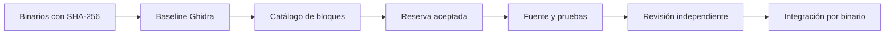

# Shaiya EP1 — reconstrucción comunitaria

[](https://github.com/Spelunkern/shaiya-ep1-reconstruction/actions/workflows/validate.yml)

Reconstrucción del cliente, servicios, herramientas y DLL de Shaiya EP1 a partir
de sus binarios originales, mediante Ghidra y aportes de agentes de IA por bloques.
La meta es obtener fuente mantenible y builds verificados de todos los binarios.

**Los binarios están incluidos en el repositorio:** 27 rutas PE, 23 binarios únicos,
unos 21 MB. Un clone obtiene los ejecutables y DLL necesarios. La distribución
pública excluye archivos de datos del cliente, bases de datos, configuraciones y
logs. Ver [distribución](docs/DISTRIBUTION.md).

```bash
git clone https://github.com/Spelunkern/shaiya-ep1-reconstruction.git
cd shaiya-ep1-reconstruction
python3 tools/reverse.py verify
python3 tools/reverse.py list --kind function --available --max-instructions 30 --limit 20
```

## Primer bloque de ejemplo

Ya hay [un aporte real completo](docs/FIRST_BLOCK.md):
`86424e839ec26fb4-fn-00001d80`, una función de `CONFIG.exe` que mide unidades de
16 bits hasta cero. Incluye fuente C, contrato ABI, ensamblador original, evidencia
del caller y **4.068 comparaciones** del código recompilado para Windows x86 contra
las instrucciones originales emuladas. Está listo para revisión independiente.

Para repetirlo, seguir [FIRST_BLOCK.md](docs/FIRST_BLOCK.md). No hace falta instalar
Ghidra para correr esas pruebas; se necesitan Python, Clang y Unicorn. Ghidra sí
forma parte del flujo para reconstruir otros bloques.

## Cómo contribuir

Seguir [CONTRIBUTING.md](CONTRIBUTING.md), leer la
[guía para agentes](docs/AGENT_GUIDE.md) y usar el
[prompt de trabajo](docs/AGENT_PROMPT.md). `AGENTS.md` contiene las reglas del repo.

```bash
python3 tools/reverse.py show ID_DEL_BLOQUE
python3 tools/reverse.py claim ID_DEL_BLOQUE --owner USUARIO_GITHUB
# Enviar la reserva por PR y esperar su aceptación antes de reconstruir.
```

Cada entrega contiene fuente, análisis por direcciones, contrato ABI, pruebas y
logs propios. La revisión vincula sus resultados al contenido exacto del aporte.
No se acepta pseudocódigo sin reconstrucción ni se inventan dependencias para
hacer compilar un bloque.



## Catálogo y estado

La baseline contiene **80.220 unidades**, de las cuales **45.259 son funciones
detectadas**. También asigna datos, recursos, regiones ejecutables sin clasificar
y trabajo de integración. El número resulta del análisis real; no se fija
artificialmente en 10.000. Las DLL idénticas comparten catálogo y conservan sus rutas.

Los rangos de cada bloque son precisos sobre un binario con hash determinado;
sus límites semánticos requieren revisión. Hay 94 funciones con flujo directo
pendiente que se excluyen de reservas normales. El detalle está en
[el análisis inicial](docs/INITIAL_ANALYSIS.md).

| Ruta | Contenido |
|---|---|
| `Client/`, `Server/` | Ejecutables y DLL originales publicados, sin data externa |
| `manifests/public-binaries.json` | Alcance y hashes de los binarios distribuidos |
| `manifests/originals.json` | Inventario histórico del corpus local completo; no obliga a descargar data |
| `analysis/baseline/` | Funciones, rangos y referencias de Ghidra |
| `blocks/` | Catálogo congelado y baseline |
| `claims/` | Reservas aceptadas |
| `contributions/` | Entregas por bloque, incluido el primer ejemplo |
| `reviews/` | Evaluaciones independientes vinculadas a cada entrega |
| `reconstruction/` | Futura integración en proyectos compilables por binario |
| `work/` | Herramientas, proyectos Ghidra y resultados locales, fuera de Git |

```bash
python3 -m unittest discover -s tests -v
python3 tools/check_distribution.py
python3 tools/reverse.py audit --originals
python3 tools/reverse.py validate
python3 tools/reverse.py report
```

El estado oficial se mide separando entregas, revisión, pruebas e integración.
El ejemplo tiene pruebas completadas y estado `ready`; todavía no hay un binario
completo reconstruido ni una evaluación independiente registrada. Recuperar
literalmente comentarios, macros y nombres eliminados del fuente original no se
puede garantizar desde un ejecutable. La identidad byte a byte del build exige
además reproducir herramientas, layout y opciones originales.
