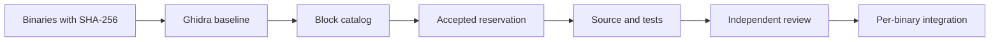

# Shaiya EP1 community reconstruction

[](https://github.com/Spelunkern/shaiya-ep1-reconstruction/actions/workflows/validate.yml)

Reconstruct the Shaiya EP1 client, services, tools, and DLLs from their original
binaries using Ghidra and community contributions by AI-assisted blocks. The goal
is maintainable source and verified builds for every unique binary.

**Binaries are included in Git:** 27 PE paths, 23 unique binaries, about 21 MB.
A clone provides the executables and DLLs needed for analysis. External client
assets, databases, configurations, and original logs are excluded from the public
corpus. See [distribution](docs/DISTRIBUTION.md).

```bash
git clone https://github.com/Spelunkern/shaiya-ep1-reconstruction.git
cd shaiya-ep1-reconstruction
python tools/reverse.py verify
python tools/reverse.py list --kind function --available --max-instructions 30 --limit 20
```

Windows users have a complete [PowerShell setup and workflow](docs/WINDOWS.md).
On Windows use `py -3.12` instead of `python`, or your virtual environment's executable.

## First reconstructed example

The [first real submission](docs/FIRST_BLOCK.md) is
`86424e839ec26fb4-fn-00001d80`, a CONFIG.exe function measuring 16-bit units up to
zero. It includes reconstructed C, ABI, original instructions, caller evidence,
and **4,068 comparisons** of Windows x86 compiled source against original
instructions in CPU emulation. It is ready for independent review.

[Run the example](docs/FIRST_BLOCK.md) with Python, Clang, and Unicorn. Ghidra
is not needed to reproduce these tests; it is used to analyze other blocks.

## Contribute

Read [CONTRIBUTING.md](CONTRIBUTING.md), the [agent guide](docs/AGENT_GUIDE.md),
and [agent prompt](docs/AGENT_PROMPT.md). `AGENTS.md` sets repository rules.

```bash
python tools/reverse.py show BLOCK_ID
python tools/reverse.py claim BLOCK_ID --owner GITHUB_USER
# Submit the reservation PR and wait for acceptance before reconstructing.
```

Each submission supplies source, address-based analysis, ABI, tests, and its own
logs. Independent review binds evidence to the exact submitted contents.



## Catalog and progress

The frozen baseline has **80,220 work units**, including **45,259 detected
functions**, data/resources, unclassified executable regions, and integration.
The count follows actual analysis. Identical DLLs share work and retain all paths.

Block ranges identify precise bytes in a specific hashed binary; semantic
boundaries still require review. There are 94 functions with unresolved outgoing
direct flow excluded from normal reservations. See [initial analysis](docs/INITIAL_ANALYSIS.md).

| Path | Purpose |
|---|---|
| `Client/`, `Server/` | Published original PE binaries without external game data |
| `manifests/public-binaries.json` | Distributed binary scope and SHA-256 |
| `manifests/originals.json` | Historical full-corpus inventory; client assets are not required |
| `analysis/baseline/` | Ghidra function boundaries and references |
| `blocks/` | Frozen catalog and baseline identity |
| `claims/` | Accepted reservations |
| `contributions/` | Block submissions, including the first example |
| `reviews/` | Independent reviews bound to submission contents |
| `reconstruction/` | Future buildable per-binary integration |
| `work/` | Local tools, projects, and results excluded from Git |

```bash
python -m unittest discover -s tests -v
python tools/check_distribution.py
python tools/reverse.py audit --originals
python tools/reverse.py validate
python tools/reverse.py report
```

Track submissions, review, verification, and integration separately. The example
has passing tests and `ready` status; no whole binary has been reconstructed or
independently accepted yet. Literal recovery of lost comments, macros, and source
names is not guaranteed. Byte-identical builds additionally require reproducing
original tools, layout, and options.

## License

Project-authored source, tooling, documentation, and contributions use
[BSD-3-Clause](LICENSE). Original binaries and third-party extracted materials
retain their respective rights and licenses; see [NOTICE.md](NOTICE.md).
